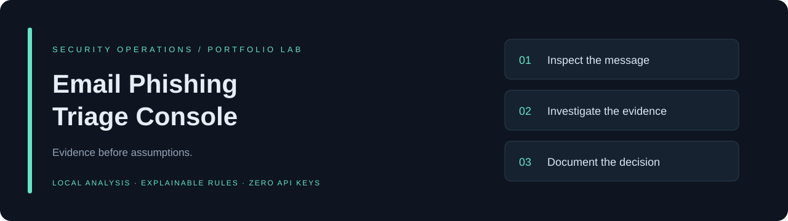

# Email Phishing Triage Console

**An offline analyst workbench for investigating suspicious email and documenting a defensible triage decision.**




The browser CI job produces desktop and mobile screenshots as a `console-screenshots` artifact.

Built as a cybersecurity portfolio lab by **Zayar Lin Tun (Henry)**. The project demonstrates MIME parsing, indicator extraction, evidence hashing, explainable detection logic, safe handling of untrusted content, and SOC investigation documentation.

> **Scope:** a working educational triage tool, not a production email gateway or a trained AI classifier. Scores prioritize manual review; they do not prove maliciousness. No email content is sent to external APIs.

## Run locally

Requires **Python 3.10 or newer** and a modern browser. No pip installation, API key, account, or paid service is required.

```bash
git clone https://github.com/HenryTun759/Email-Phishing-Triage-Console.git
cd Email-Phishing-Triage-Console
python3 app.py
```

Open **http://127.0.0.1:8765**. On Windows, use `py app.py` if `python3` is unavailable. Stop the server with `Ctrl+C`.

The server binds to loopback only. Keep it local: it is not designed for public hosting or multi-user deployments.

## Try it in two minutes

1. Select **Credential lure** to load and analyze a synthetic email.
2. Inspect the **High / 100** review priority and the evidence behind each rule.
3. Open **Indicators** for defanged URLs and attachment hashes; open **Headers** for reported authentication and the Received chain.
4. Record your disposition and investigation notes.
5. Export a Markdown case report or structured JSON evidence record.
6. Compare **Suspicious invoice** (55 / High) and **Routine update** (0 / Low).

All samples use reserved example domains and documentation IP addresses. The invoice attachment contains inert training text. No real phishing campaign or malware is included.

## What works

| Capability | Implementation |
| --- | --- |
| Email intake | Upload original `.eml` bytes or paste complete email source; 2 MiB limit |
| MIME parsing | Plain text, HTML text extraction, multipart messages, base64 and quoted-printable decoding |
| Header inspection | From, To, Reply-To, Date, Message-ID, Received, and reported SPF/DKIM/DMARC results |
| URL analysis | HTTP(S) extraction, defanging, visible-link mismatch, IP destinations, user-info and punycode signals |
| Attachment evidence | Name, MIME type, decoded byte count and SHA-256; risky/double extensions |
| Explainable scoring | Named rules, visible points, evidence, capped score and recommended next steps |
| Analyst workflow | Investigation tabs, disposition, notes, Markdown and JSON downloads |
| Safe display | Text-only DOM rendering, no remote images, no link retrieval, no attachment execution |
| Verification | Python unit/integration tests, browser smoke test, GitHub Actions |

## Architecture

```text
Browser (vanilla HTML/CSS/JS)
  → loopback HTTP service (Python standard library)
  → MIME parser and deterministic rules
  → structured findings and evidence
  → analyst review and local report download
```

- `triage/analyzer.py` — parsing, evidence extraction and scoring; no networking code.
- `app.py` — fixed-route local HTTP service with request limits and security headers.
- `web/` — responsive dashboard; untrusted fields are inserted with `textContent`.
- `samples/` — three synthetic investigations.
- `tests/` — parser, evidence, server boundary and browser workflow checks.
- `docs/` — methodology, worked case, security model and interview walkthrough.

See [detection methodology](docs/METHODOLOGY.md), [worked investigation](docs/CASE_STUDY.md), and [demo walkthrough](docs/DEMO.md).

## Test

```bash
python3 -m unittest discover -s tests -v
```

Optional browser verification (Node.js plus Playwright):

```bash
npm install --no-save --package-lock=false playwright
npx playwright install chromium
# Start python3 app.py in another terminal, then:
node tests/browser-smoke.cjs
```

The browser test covers sample analysis, tabs, notes, report downloads, file upload, script-injection handling, validation errors, reset and mobile overflow. Python CI runs on 3.10, 3.12 and 3.13.

## Limitations that matter

- **No live SPF/DKIM/DMARC validation.** Uploaded `Authentication-Results` headers can be forged. Confirm the receiving gateway and trust boundary independently.
- **No reputation lookup, DNS resolution, redirect following, antivirus or sandbox detonation.** A hash is an identifier, not a malware verdict.
- **No calibrated accuracy claim.** Rule weights and thresholds are illustrative, not trained or validated against a representative labeled dataset.
- Exact hostname/domain comparisons can flag legitimate third-party services and subdomains. Brand ownership and public-suffix relationships are not resolved.
- Only HTTP(S) text and HTML anchor URLs are extracted. QR codes, images, obfuscation, archives and attachment contents are not analyzed. Encrypted emails are not decrypted.
- Attached multipart/email containers are listed but not recursively investigated or hashed as decoded files. Analyze those separately in approved tooling.
- Notes and results live in browser memory and are lost on refresh. Export before clearing or closing. Reports may contain sensitive information.
- This is a local single-user tool with a small HTTP server, not a hardened hosted service. Read [SECURITY.md](SECURITY.md).

## Portfolio discussion

Be ready to explain why a low score does not mean safe, why authentication headers require a trusted source, how SHA-256 supports evidence integrity, and how you would validate detections using labeled examples. See [the interview walkthrough](docs/DEMO.md) for a practical demonstration plan.

## Possible next steps

- Evaluate false positives and false negatives against an authorized, labeled corpus.
- Add configurable organization domains and a public-suffix-aware comparison.
- Add opt-in hash-only reputation enrichment with explicit data-sharing controls.
- Add case persistence, access control and audit history only if moving beyond a local lab.
